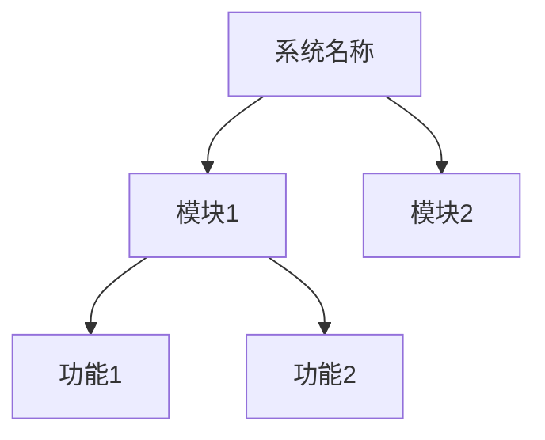
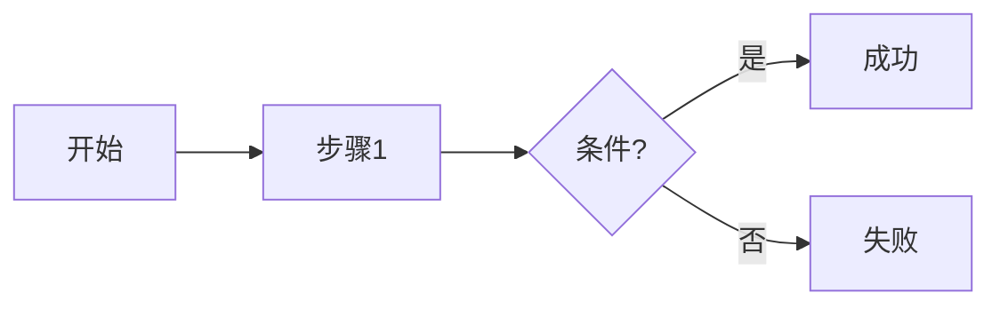
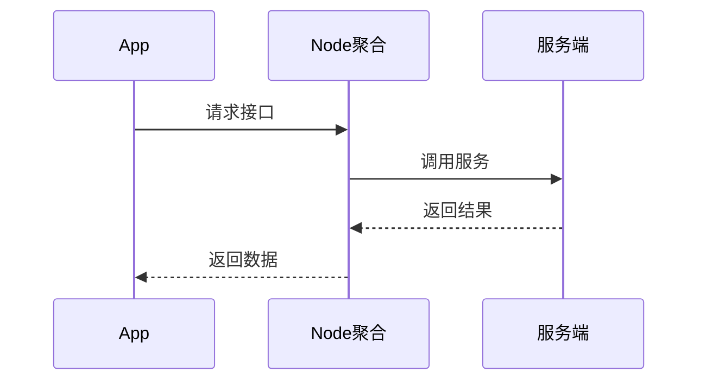
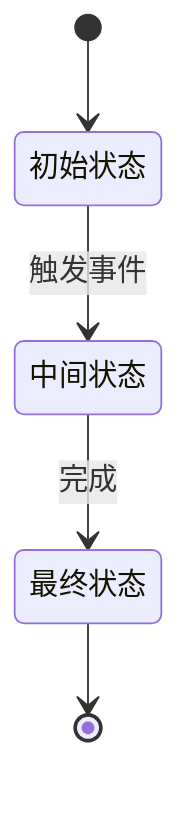
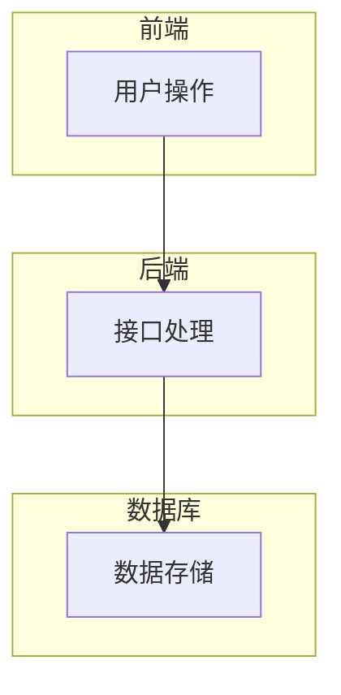

# 测试点提炼技能

从需求文档中提取结构化测试点，输出可视化分析报告。

## Codex 执行约定

- 这个目录就是 skill 根目录。脚本和参考文档从本目录解析；需求输入和报告输出从项目工作区解析。
- 默认工作区为当前项目的 `workspace/`。如果用户指定了其他工作区，保留该路径，不要把文件复制到 skill 安装目录。
- 先读取 `references/output-schema.md`，需要格式化报告时再调用 `scripts/testpoint_formatter.py`。
- 图表脚本只负责生成 Mermaid 文本。使用 `scripts/diagram_generator.py --input ... --type ... --output ...` 后，确认输出文件确实存在再继续。
- 输入材料解析失败时说明具体文件和缺少的能力，不要用示例数据代替真实需求。

## 核心能力

- **多模态输入**：支持文档（Markdown/Word/PDF）+ 图片（原型图/截图）
- **8 维度分类**：功能/层次/类型/优先级/生命周期/场景/角色/时间
- **可视化图表**：自动生成流程图、时序图、泳道图、状态图
- **结构化输出**：Markdown + Mermaid 图表 + JSON 数据
- **需求追溯**：每个测试点可追溯到具体需求

## 工作流程

### 阶段 1：读取需求材料

**输入位置**：`workspace/input/requirements/`

**支持格式**：
- 文档：`.md`, `.txt`, `.docx`, `.pdf`
- 图片：`.png`, `.jpg`, `.jpeg`（OCR 识别）

**处理逻辑**：
1. 扫描输入目录下的所有文件
2. 按文件类型分类处理
3. 图片使用 OCR 提取文字（如果需要）
4. 合并所有内容为统一需求文本

### 阶段 2：需求要素提取

从需求文本中提取关键信息：

| 要素类型 | 提取内容 | 识别关键词 |
|---------|---------|-----------|
| **功能模块** | 一级/二级/三级功能划分 | "模块"、"功能"、"页面"、"接口" |
| **业务规则** | 判断条件、计算规则、约束 | "如果...则"、"当...时"、"规则" |
| **数据流** | 输入/输出/传递关系 | "输入"、"输出"、"参数"、"返回" |
| **状态流转** | 生命周期、状态机 | "状态"、"流程"、"从...到" |
| **接口调用** | API 序列、调用链路 | "调用"、"请求"、"接口"、"API" |
| **交互关系** | 模块依赖、前后置条件 | "依赖"、"前置"、"触发"、"联动" |
| **验收条件** | 可验证的预期结果 | "验收"、"预期"、"应该"、"必须" |
| **歧义缺失** | 不明确/矛盾/缺失信息 | 标记为待确认 |

### 阶段 3：测试点分类归纳（8 维度）

#### 维度 1：功能维度
- **主流程**：核心业务正向流程（必测）
- **核心功能**：关键业务能力验证
- **交互功能**：模块间联动、数据传递
- **常用功能**：高频操作场景
- **辅助功能**：帮助、设置、通知
- **管理功能**：后台配置、权限管理

#### 维度 2：层次维度
- **UI 层**：界面展示、交互反馈
- **接口层**：API 调用、参数校验
- **业务逻辑层**：规则计算、流程控制
- **数据层**：数据库操作、数据一致性
- **集成层**：第三方服务、外部依赖

#### 维度 3：类型维度
- **功能性**：业务功能正确性
- **非功能性**：性能、可用性、可靠性
- **兼容性**：浏览器、设备、系统
- **安全性**：权限、注入、加密
- **易用性**：用户体验、操作便捷性

#### 维度 4：优先级维度
- **P0 核心**：阻塞性，影响主流程
- **P1 主要**：严重缺陷，影响核心功能
- **P2 次要**：一般缺陷，影响辅助功能
- **P3 边缘**：轻微缺陷，极端场景

#### 维度 5：生命周期维度（CRUD+）
- **新增（Create）**：创建数据
- **查询（Read）**：检索数据、列表展示
- **修改（Update）**：更新数据
- **删除（Delete）**：移除数据
- **导入（Import）**：批量导入
- **导出（Export）**：批量导出
- **审核（Approve）**：审批流程

#### 维度 6：场景维度
- **正常场景**：符合预期的标准流程
- **边界场景**：临界值、极限条件
- **异常场景**：错误输入、异常状态
- **极端场景**：并发、大数据量、弱网

#### 维度 7：用户角色维度
- **普通用户**：基础权限
- **VIP 用户**：增强权限
- **管理员**：完整权限
- **游客**：未登录状态
- **其他角色**：根据业务定义

#### 维度 8：时间维度
- **首次使用**：新用户场景
- **日常使用**：常规操作
- **过期场景**：token 过期、数据过期
- **高峰场景**：流量高峰期

### 阶段 4：可视化图表生成（Mermaid）

根据需求内容自动生成以下图表：

#### 1. 功能模块结构图（树图/思维导图）


#### 2. 业务流程图（流程图）


#### 3. 接口调用链路图（时序图）


#### 4. 状态转换图（状态图）


#### 5. 数据流转图（泳道图）


### 阶段 5：输出测试点清单

**输出位置**：`workspace/output/test-points/test-points-[需求名称]-[时间戳].md`

**文件结构**：
```markdown
# 测试点分析报告：[需求名称]

## 1. 需求概述
[自动生成的需求摘要]

## 2. 可视化图表

### 2.1 功能模块结构图
[Mermaid 图表]

### 2.2 业务流程图
[Mermaid 图表]

### 2.3 接口调用链路图
[Mermaid 图表]

### 2.4 状态转换图
[Mermaid 图表]

## 3. 测试点矩阵

### 3.1 功能维度测试点
[按主流程/核心/交互/常用分类]

### 3.2 层次维度测试点
[按UI/接口/业务/数据/集成分类]

### 3.3 类型维度测试点
[按功能/非功能/兼容/安全分类]

[... 其他维度]

## 4. 测试覆盖度分析
[统计表格]

## 5. 风险与待确认
[高风险点 + 待确认问题清单]

## 6. 测试点数据（机器可读）
```json
{
  "metadata": {...},
  "test_points": [...]
}
```
```

**JSON 数据结构**（供测试用例生成技能使用）：
```json
{
  "metadata": {
    "requirement_name": "需求名称",
    "generated_at": "2026-09-08T16:30:00",
    "version": "1.0",
    "total_test_points": 50
  },
  "test_points": [
    {
      "id": "TP-001",
      "title": "测试点标题",
      "dimension_function": "主流程",
      "dimension_layer": "接口层",
      "dimension_type": "功能性",
      "dimension_priority": "P0",
      "dimension_lifecycle": "查询",
      "dimension_scenario": "正常场景",
      "dimension_role": "普通用户",
      "dimension_time": "日常使用",
      "requirement_id": "REQ-001",
      "requirement_source": "需求文档第3段",
      "description": "详细描述",
      "precondition": "前置条件",
      "input": "输入数据",
      "expected": "预期结果",
      "suggested_methods": ["ST", "EP"]
    }
  ]
}
```

## 交互模式

采用**快速模式** + **关键节点确认**。如果用户已经明确授权完成分析，只有歧义会改变测试结论时才暂停询问；普通的阶段提示不应阻塞执行：

### 检查点 1：需求解析确认（阶段 2 后）
```
已识别：
- 功能模块：X 个
- 业务规则：Y 条
- 接口调用：Z 个

发现以下待确认问题：
1. [歧义描述]
2. [缺失信息]

如果歧义会改变测试结论，列出待确认问题并暂停；否则标记为“待确认”后继续。
```

### 检查点 2：测试点预览（阶段 3 后）
```
已提取测试点：
- 主流程：15 个
- 核心功能：28 个
- 交互功能：12 个
- 总计：55 个

覆盖度：96%

报告生成前检查 JSON 契约、需求追溯和待确认问题。
```

## 质量标准

- ✅ 测试点提取准确率 ≥ 95%
- ✅ 所有测试点可追溯到需求
- ✅ 图表自动生成，无需手动绘制
- ✅ 不凭空编造需求中不存在的内容
- ✅ 歧义和缺失信息必须标注
- ✅ 输出格式规范，便于人工评审

## 约束

- **不编造**：所有测试点必须源自需求文档
- **标注歧义**：不明确的内容必须标记为待确认
- **图文并茂**：输出必须包含可视化图表
- **结构化数据**：必须输出 JSON 数据块供下游使用
- **中文输出**：所有面向用户的内容使用中文

## 脚本调用

### 生成 Mermaid 图表
```bash
python3 "<skill-root>/scripts/diagram_generator.py" \
  --input "<diagram-input.json>" \
  --type "flowchart" \
  --output "<workspace>/output/test-points/flowchart.mmd"
```

### 格式化测试点输出
```bash
python3 "<skill-root>/scripts/testpoint_formatter.py" \
  --input "testpoints.json" \
  --template "<skill-root>/references/output-template.md" \
  --output "<workspace>/output/test-points/report.md"
```

## 参考文档

- [extraction-dimensions.md](references/extraction-dimensions.md) - 8 维度详细定义
- [requirement-parsing.md](references/requirement-parsing.md) - 需求解析规则
- [diagram-templates.md](references/diagram-templates.md) - Mermaid 图表模板库
- [output-schema.md](references/output-schema.md) - 输出格式规范

## 触发关键词

- "测试点"
- "提炼测试点"
- "分析需求"
- "提取测试维度"
- "需求分析"
- "测试点提取"

---

**版本**：v2.0.0
**更新日期**：2026-09-08
**依赖**：Python 3.11+；Mermaid 文本生成使用标准库，图片渲染需单独配置渲染器
**更新内容**：增加"测试点"关键词
