# Mermaid 图表模板库

本文档提供常用的 Mermaid 图表模板，用于可视化需求分析结果。

---

## 1. 功能模块结构图（树图/思维导图）

**适用场景**：展示系统的功能模块层级结构

### 模板 1：横向树图
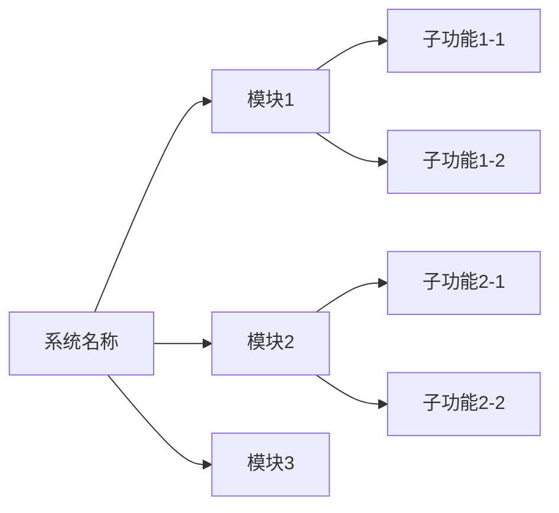

### 模板 2：纵向树图
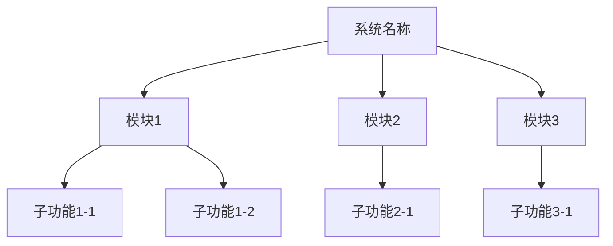

### 模板 3：带样式的树图
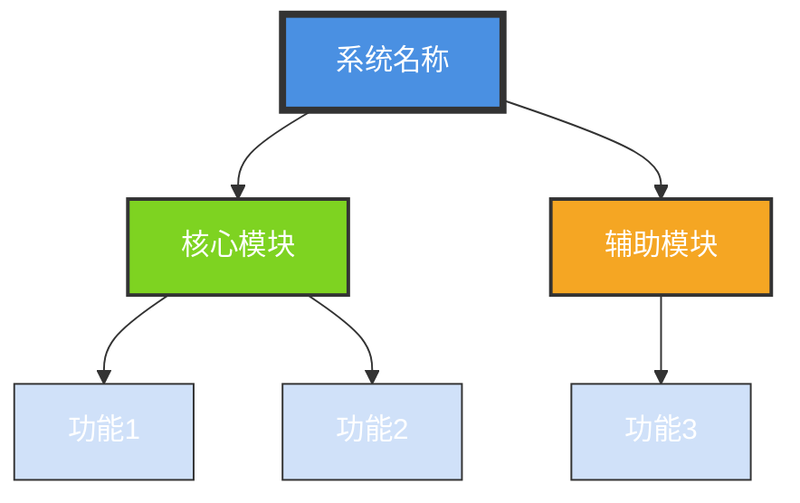

---

## 2. 业务流程图（流程图）

**适用场景**：展示业务流程的步骤和分支

### 模板 1：基础流程图
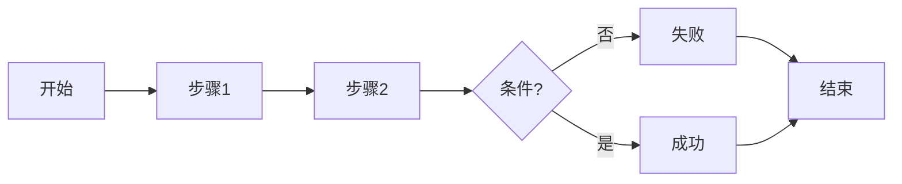

### 模板 2：纵向流程图（适合长流程）
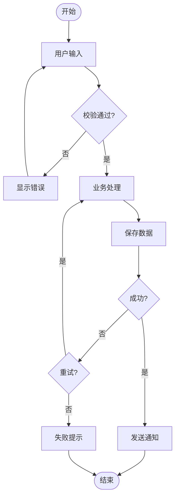

### 模板 3：泳道式流程图（多角色）
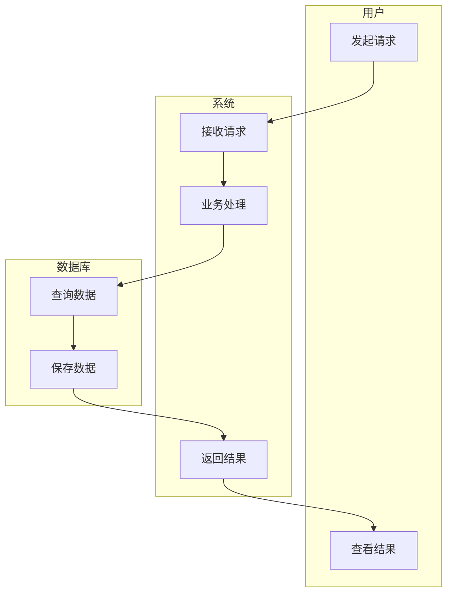

---

## 3. 接口调用链路图（时序图）

**适用场景**：展示 App/前端 → Node 聚合 → 服务端的调用关系

### 模板 1：基础时序图
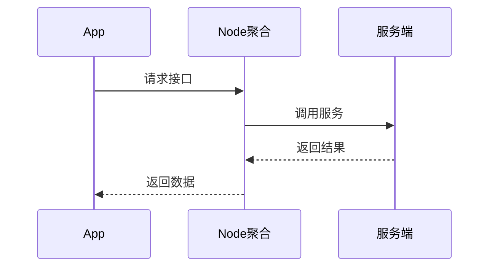

### 模板 2：带错误处理的时序图
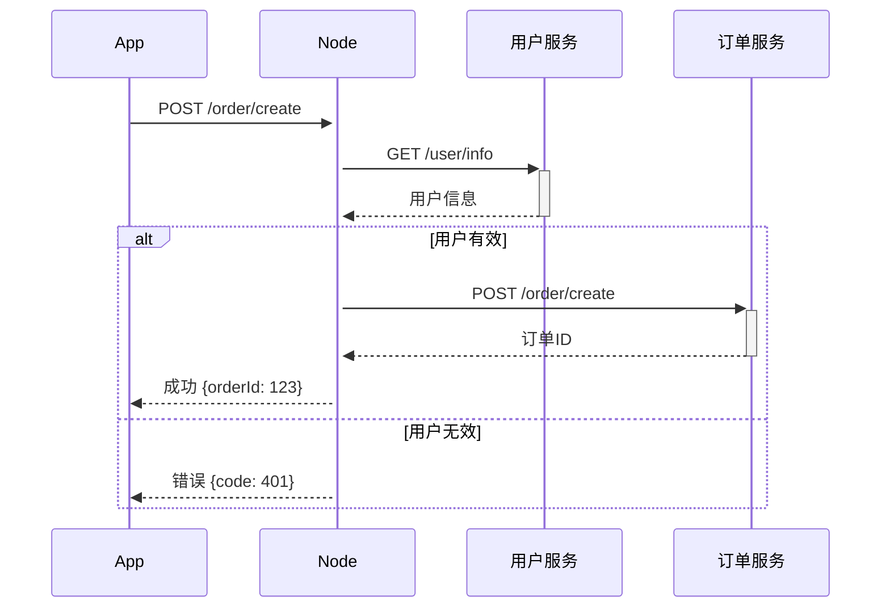

### 模板 3：并行调用时序图
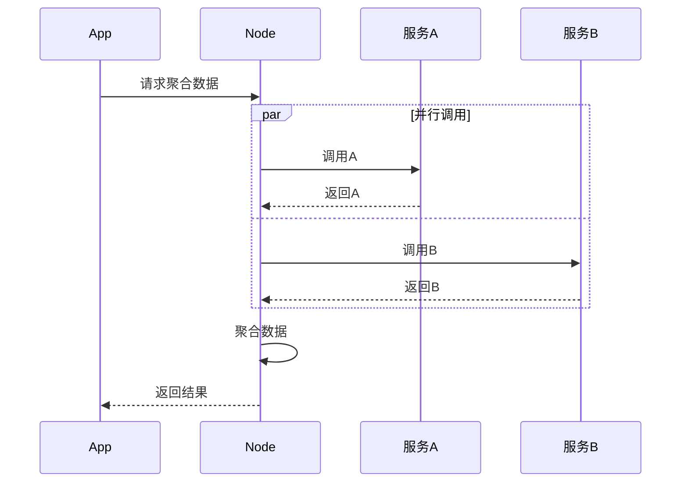

---

## 4. 状态转换图（状态图）

**适用场景**：展示数据的生命周期和状态流转

### 模板 1：基础状态图
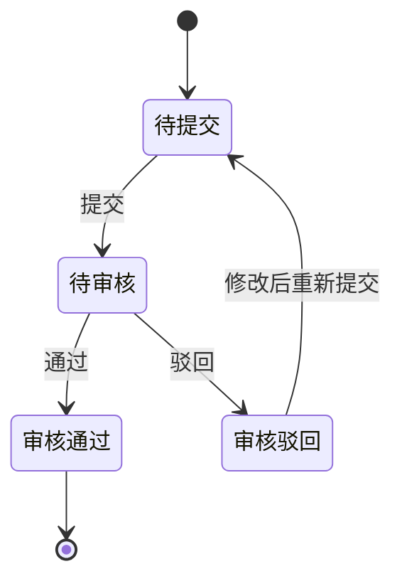

### 模板 2：复杂状态图（订单状态）
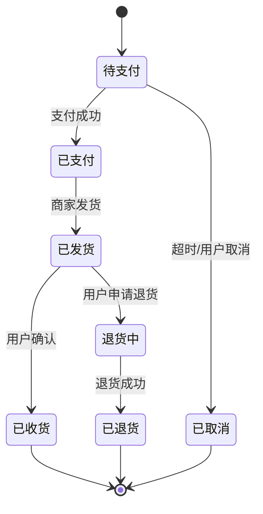

### 模板 3：带备注的状态图
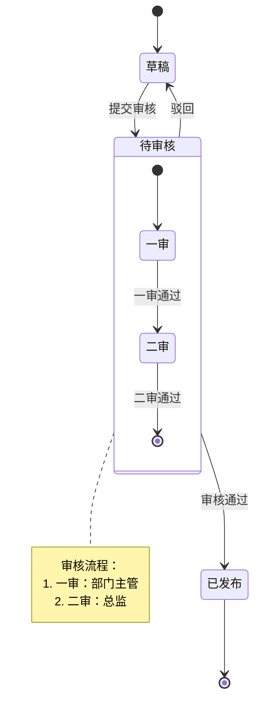

---

## 5. 数据流转图（Graph）

**适用场景**：展示数据在不同模块间的流转

### 模板 1：基础数据流图
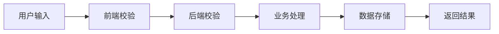

### 模板 2：分层数据流图
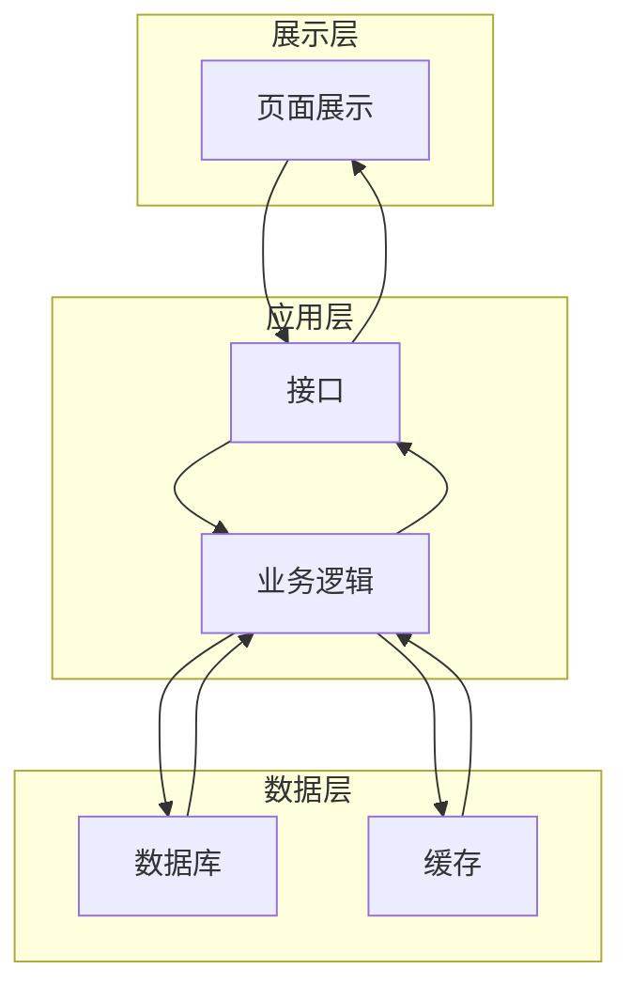

---

## 6. ER 图（实体关系图）

**适用场景**：展示数据库表结构和关系

### 模板 1：基础 ER 图
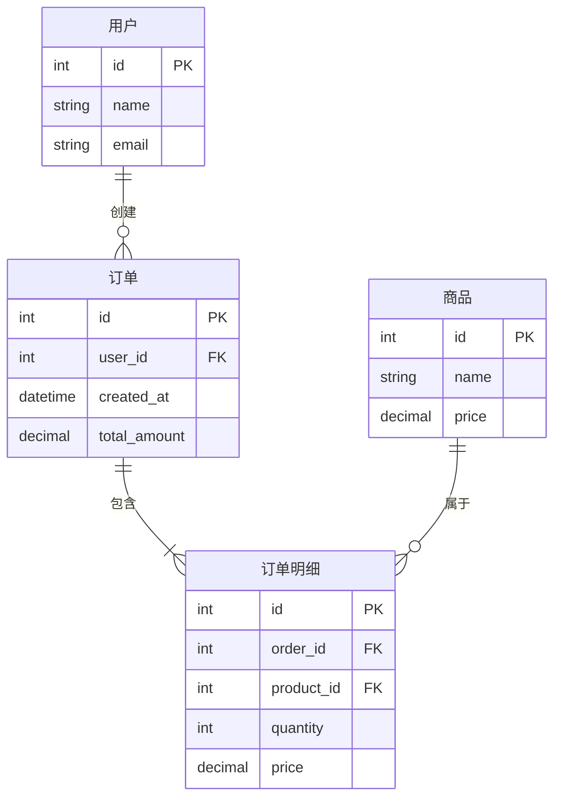

---

## 7. 甘特图（项目进度）

**适用场景**：展示测试计划和进度

### 模板 1：测试阶段甘特图
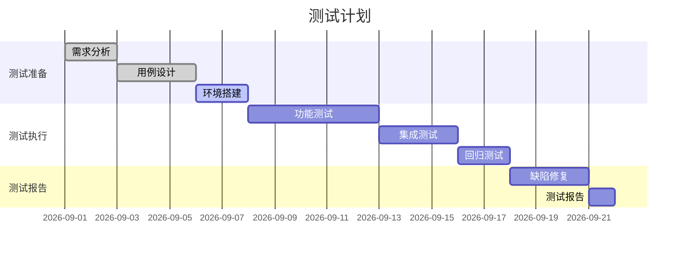

---

## 8. 饼图（覆盖度统计）

**适用场景**：展示测试点分布或优先级分布

### 模板 1：优先级分布饼图
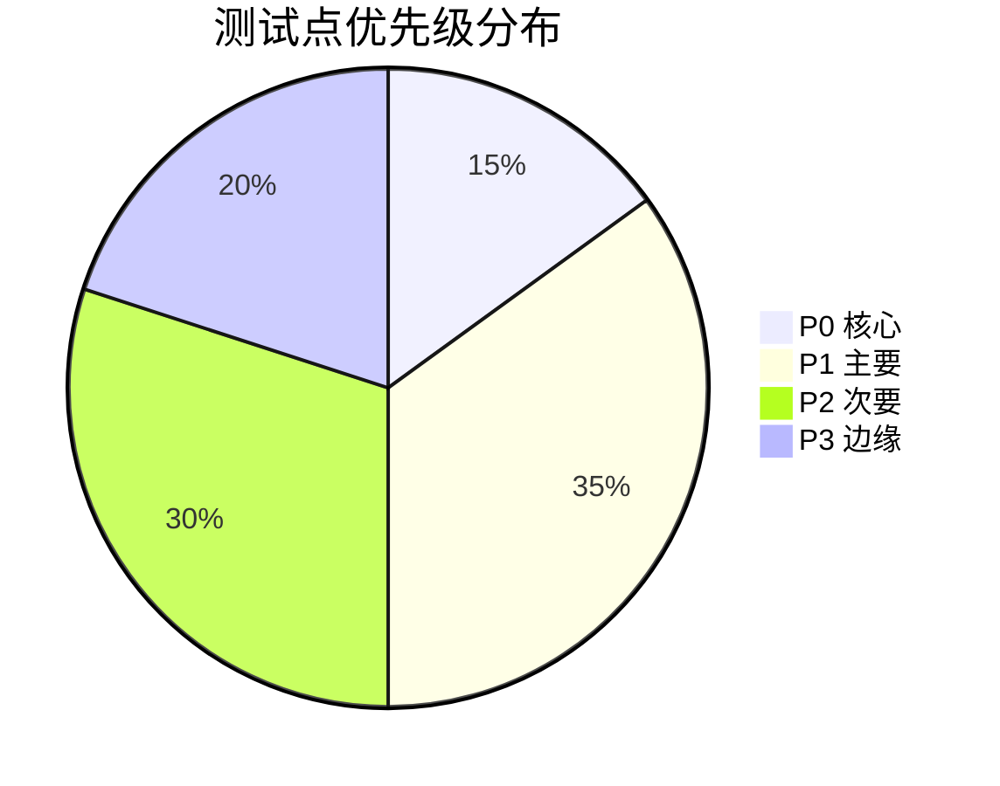

### 模板 2：功能维度分布饼图
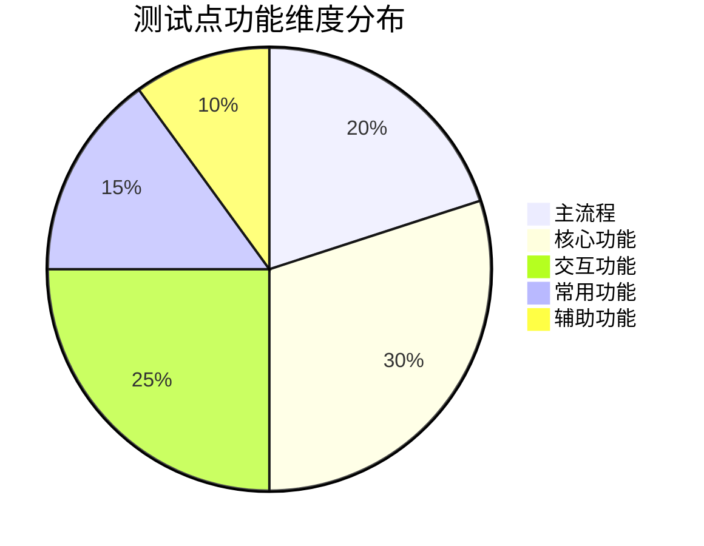

---

## 9. 类图（面向对象）

**适用场景**：展示系统架构或模块关系

### 模板 1：简单类图
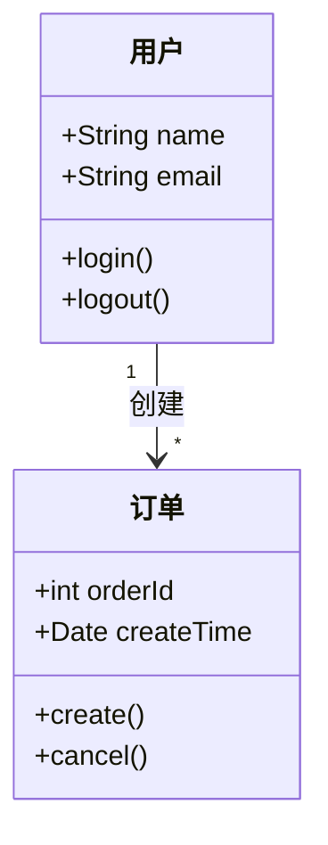

---

## 10. Git 图（分支流程）

**适用场景**：展示开发分支和发布流程

### 模板 1：Git Flow
```mermaid
gitgraph
    commit
    branch develop
    checkout develop
    commit
    branch feature/login
    checkout feature/login
    commit
    commit
    checkout develop
    merge feature/login
    checkout main
    merge develop
    commit tag: "v1.0"
```

---

## 使用建议

### 根据需求类型选择图表

| 需求特征 | 推荐图表 |
|---------|---------|
| 包含功能模块划分 | 功能模块结构图（树图） |
| 包含多步骤流程 | 业务流程图（流程图） |
| 包含接口调用 | 接口调用链路图（时序图） |
| 包含状态变化 | 状态转换图（状态图） |
| 包含数据流转 | 数据流转图（Graph） |
| 包含数据库表 | ER 图 |
| 包含统计分布 | 饼图 |

### 图表组合建议

**完整的测试点分析报告通常包含**：
1. 功能模块结构图（必须）
2. 业务流程图（如有流程）
3. 接口调用链路图（如有接口）
4. 状态转换图（如有状态）
5. 测试点分布饼图（统计用）

---

**最后更新**：2026-09-08
